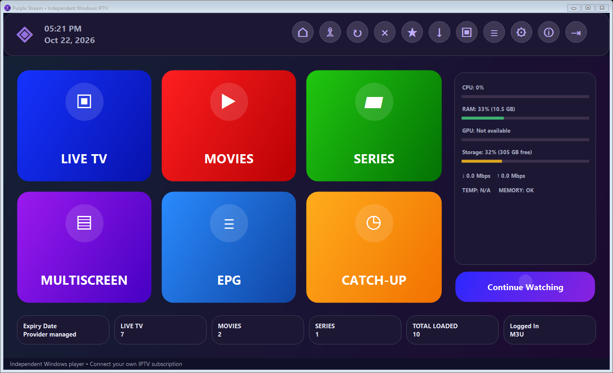
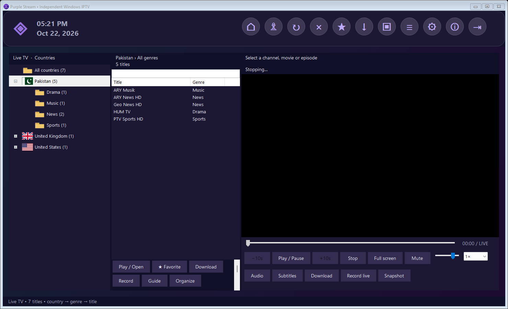
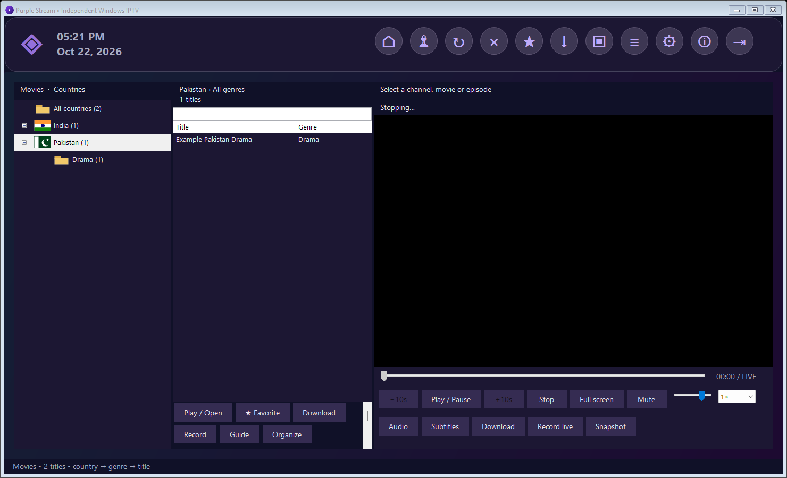
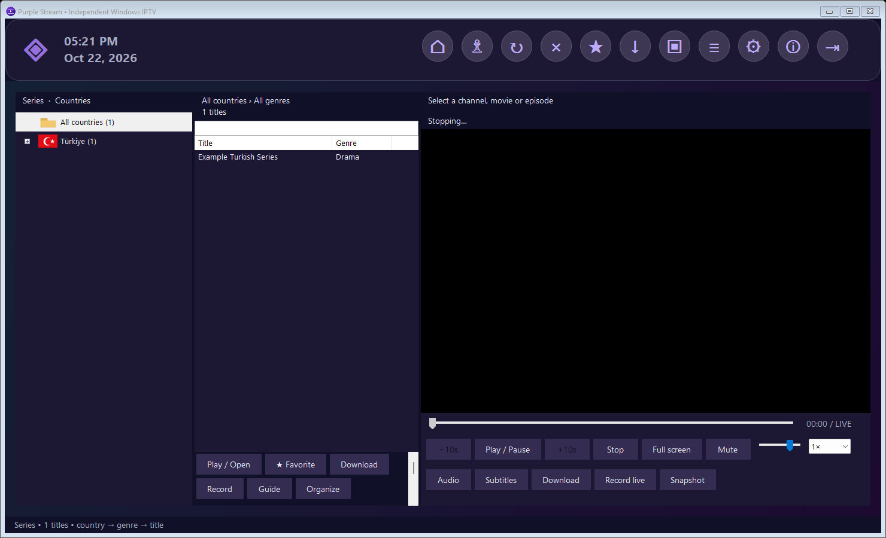
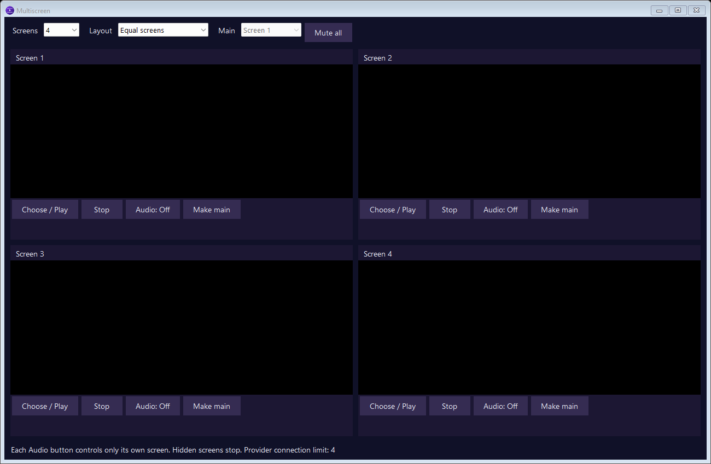
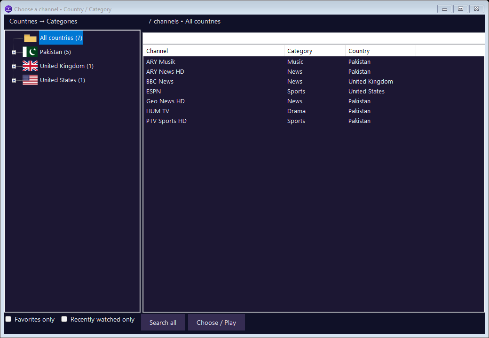
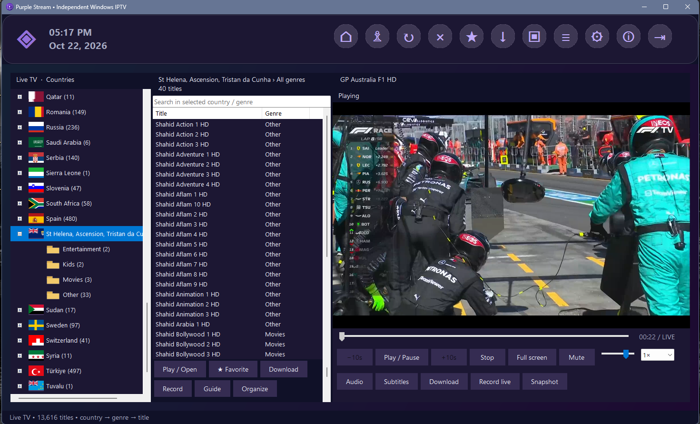
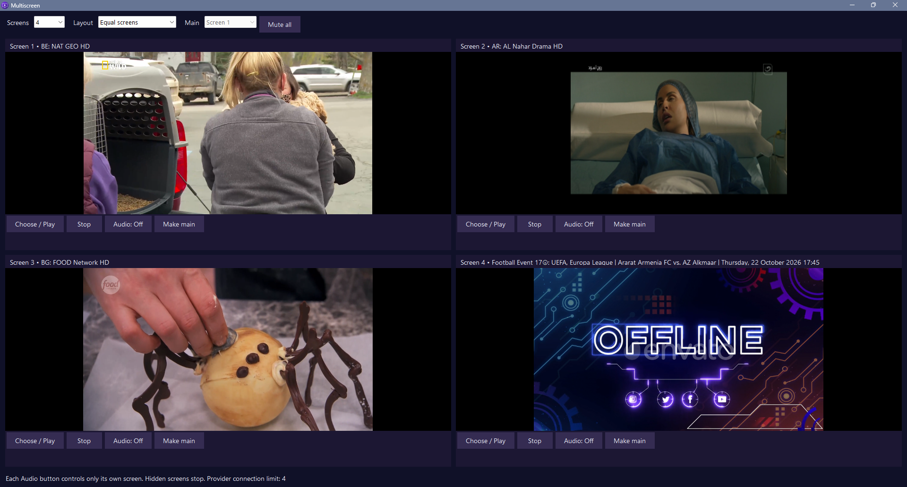
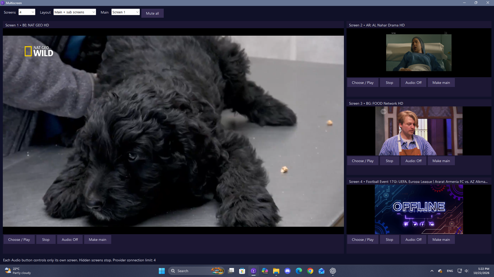

<h1 align="center">Purple Stream</h1>

Your IPTV library, organized for Windows.

Windows 10/11 · x64 · Native desktop · MIT application code

[اردو رہنمائی](README.ur.md) · [User guide](docs/USER-GUIDE.md) · [Features](docs/FEATURES.md) · [Build](docs/BUILD.md) · [Privacy](docs/PRIVACY.md)

Purple Stream is an independent native Windows IPTV player with a colorful dark-purple dashboard, country and genre browsing, and a flexible multiscreen player. Connect your own Xtream Codes account or M3U playlist. No Android emulator, channels, subscriptions, or provider accounts are included.

## Why use it?

- Find content faster: Live TV, Movies and Series are organized by country, flag and genre; search, favorites and recent items reduce scrolling.
- Watch your way: playback controls, resume history, and 2, 3 or 4 screens with independent audio and a main/sub-screen layout.
- Keep content on your PC: movie/episode downloads and live recording, subject to stream support and your provider's permissions and connection allowance.
- Install once: a per-user installer creates Start Menu and optional Desktop shortcuts. Windows can pin the shortcut to the taskbar.
- Keep account data local: remembered settings, favorites and history are encrypted for the current Windows user.

## Download and install

Open [**Releases**](https://github.com/AliKirmani/PurpleStream/releases) and download `PurpleStream-Setup-v0.4.3.exe`. Run it, choose Install, then open **Purple Stream** from Start. Alternatively, extract the complete `PurpleStream-v0.4.3-Windows-x64.zip` and run `PurpleStream.exe`; keep its accompanying files together. Release assets are supplied separately from the source repository.

Connect using **Account** in the toolbar. Use your provider's details, or choose an M3U file. See the [step-by-step guide](docs/USER-GUIDE.md).

## Gallery

The six original images below are captures of the actual app using synthetic sample catalog entries. They do not show an active subscription, licensed broadcasts or real account information. The multiscreen capture shows the available controls with empty playback slots.

| Live TV | Movies |
| --- | --- |
|  |  |
| Series | Multiscreen |
|  |  |

## User screenshots

The project owner supplied these screenshots of playback in their own installation. Displayed channels/programmes are examples only and are not bundled with Purple Stream. A dashboard screenshot containing a personal account identifier was excluded. Country inference can be imperfect with ambiguous provider metadata.

## Feature status

Implemented: Xtream/M3U login, country/genre catalogs, favorites, series episodes, playback controls, multiscreen, EPG, catch-up, downloads and live recording. EPG needs a supplied schedule; catch-up needs provider archives. Live seeking, codecs, downloads and simultaneous streams depend on the source and account. Country/genre inference can be corrected manually. See the [full feature and limitations matrix](docs/FEATURES.md).

## Development

Built with C#, Windows Forms, .NET 8 and dynamically linked LibVLC. [Build and test instructions](docs/BUILD.md), [architecture](docs/ARCHITECTURE.md), [validation notes](docs/VALIDATION.md), [changelog](CHANGELOG.md) and [contribution guide](CONTRIBUTING.md) are included. A static GitHub Pages site is in `site/`; [publication instructions](docs/PUBLISHING.md) explain Releases and Pages.

Original application code is [MIT licensed](LICENSE). LibVLC and other dependencies retain their own licenses; see [third-party notices](THIRD-PARTY-NOTICES.txt) and [LGPL text](LGPL-2.1.txt). This project is not affiliated with Smart IPTV Stream Pro, its developer, VideoLAN, or any IPTV provider. Its original dashboard was inspired by a visual reference; proprietary code, branding and assets are not included. Use content you are authorized to access and record. DRM circumvention is not supported.

